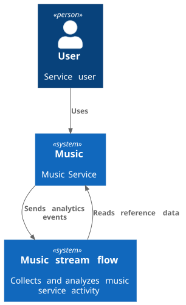
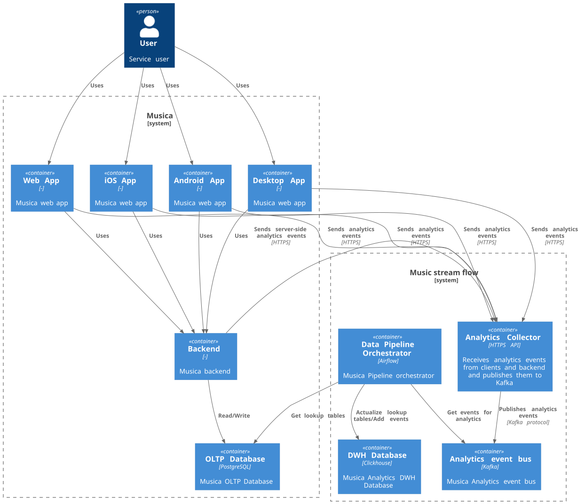
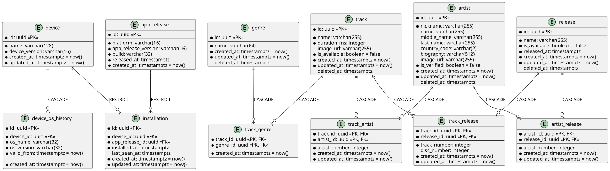
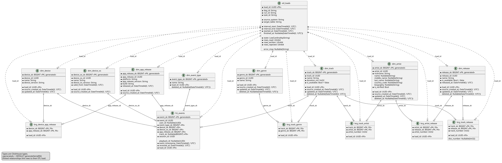
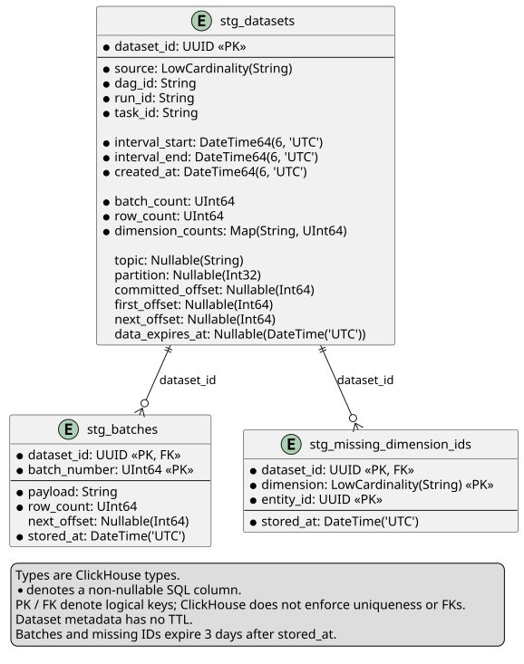

# music-stream-flow

[English](README.md) | [Русский](README.ru.md)

An analytics platform for a music streaming service. The project combines reference data from PostgreSQL and user events from Kafka in a ClickHouse data mart. Apache Airflow orchestrates the loading process.

Two independent generators stand in for a real music application: one populates and updates the OLTP database, while the other produces consistent user sessions and publishes events to Kafka.

## Analytics

The SQL queries in [analytics/queries](analytics/queries) provide:

- Top device models and operating systems by session count.
- Top tracks by selections and likes, including rankings for a specified period.
- Top albums and artists by track selections.
- Average session duration, both overall and per user.

Requirements are documented in [analytics/mart_spec.md](analytics/mart_spec.md). In this version, track selection (`track_selected`) is used as a proxy for listening; actual playback duration is not measured.

## Architecture

### System Context — C4 L1

The music service sends events to the analytics platform, which also reads reference data from the service.



### Containers — C4 L2



The diagrams show the target architecture: client applications and the backend send events to an `Analytics Collector`, which publishes them to Kafka. The applications, backend, and collector are not implemented in this repository. In the runnable environment, generators replace them, and the event generator writes directly to Kafka.

- **PostgreSQL** — operational data: devices, OS history, application releases, installations, the music catalog, and relationships between entities.
- **Kafka** — a stream of JSON events in the `music-events` topic by default. Messages are keyed by `session_id`, so events from the same session go to the same partition.
- **Airflow** — incremental batch loading, dependency resolution, and monitoring of stage completion.
- **ClickHouse** — an analytical warehouse with two shards and two replicas per shard, replicated tables, and Distributed wrappers. ZooKeeper provides coordination.
- **Python** — generators and ETL using Faker, Psycopg, SQLAlchemy/asyncpg, clickhouse-connect, and confluent-kafka.

### Loading Workflow

The [`etl_msf`](airflow/pipelines/etl_msf.py) DAG runs hourly and allows one active run at a time:

1. `fix_timestamp` establishes the `[timestamp_start, timestamp_end)` interval, starting from the last successfully processed boundary.
2. Parallel staging tasks read relationships from OLTP and events from each Kafka partition. They save the source batches in ClickHouse and collect UUIDs of dimensions not yet present in the DWH. Kafka offsets are not committed at this stage.
3. `collect` combines the missing UUIDs from all staging datasets. Tasks exchange only `dataset_id` references, not the batches themselves.
4. Dimension tasks load OLTP records by time interval **or** by missing UUIDs. This loads dependencies even when their current `updated_at` falls outside the interval.
5. Bridge tables are loaded first, followed by facts for each Kafka partition, using the saved staging batches. Transformers resolve surrogate keys; an offset is committed only after the corresponding fact batch has been inserted successfully.
6. `swap_timestamp` saves the new boundary only after all loads succeed. Load results and row counts are recorded in `etl_loads`.

Staging batch contents and missing UUID sets have a three-day TTL. Metadata for completed datasets is retained without a TTL. Expired or incomplete datasets are rejected rather than treated as empty.

Extraction is timestamp-based rather than WAL-based CDC. Dimensions reflect the current source state, not the historical state at the time of an event. There is no shared transaction between Kafka and ClickHouse: a failure between insertion and offset commit can cause reprocessing. ReplacingMergeTree removes matching records during merges, and analytical queries use `FINAL`.

## Data Models

### OLTP

The normalized schema stores the music catalog, devices, and installations. OS versions are maintained in a separate history table. The generator creates entities and their relationships consistently, respecting foreign key constraints.



DDL: [sql/music_oltp/ddl](sql/music_oltp/ddl). Diagram source: [PlantUML](sql/music_oltp/docs/ddl.puml).

### DWH

The data mart uses dimensional modeling: one row in `fct_events` represents one event. The `dim_*` dimensions provide descriptive context, `brg_*` bridge tables represent many-to-many relationships, and `etl_loads` stores load audit records. Source UUIDs are retained alongside dimension surrogate keys.



DDL and event type seed data: [sql/dwh/ddl](sql/dwh/ddl). Diagram source: [PlantUML](sql/dwh/docs/ddl.puml).

### Staging

The staging layer stores dataset metadata, source batches, and missing dimension UUIDs. The three tables are linked by `dataset_id` and are shown separately from the analytical model.



DDL: [0003-staging.sql](sql/dwh/ddl/0003-staging.sql). Diagram source: [PlantUML](sql/dwh/docs/staging.puml).

## Data Generation

- [`oltp_generator`](generators/oltp_generator) inserts and updates PostgreSQL data. INSERT and UPDATE streams have independent limits, periods, and intervals. Devices, compatible operating systems, and genres come from shared [catalogs](generators/catalogs); creating relationships does not consume parent entity quotas.
- [`event_generator`](generators/event_generator) reads existing installations and available tracks from OLTP. It produces sequences such as `session_started → track_selected → [track_liked / track_disliked] → … → session_ended`. Device and application context remains fixed throughout a session; anonymous sessions do not produce reactions.

The generators run in separate containers and are configured through `generators/.env`. Event quotas, delivery intervals, and the number of active sessions can be adjusted independently of the OLTP data stream.

## Repository Structure

- [airflow](airflow) — the DAG, connectors, extractors, transformers, mappers, loaders, staging, and ETL tests.
- [analytics](analytics) — data mart requirements, analytical SQL queries, and query tests.
- [generators](generators) — OLTP and event generators, shared catalogs, and Docker Compose.
- [sql](sql) — PostgreSQL and ClickHouse DDL, seed data, and ER diagrams.
- [postgresql](postgresql), [clickhouse](clickhouse), [kafka](kafka) — infrastructure configuration and startup.
- [docs](docs) — C4 diagram sources and SVG images of the architecture and data models.

## Quick Start

Docker with Docker Compose and `make` are required. Run all commands below from the repository root.

### 1. Configure the Environment

Create a `.env` file from `.env.example` in each of the `airflow`, `clickhouse`, `generators`, `kafka`, and `postgresql` directories. Keep database names, usernames, passwords, the topic name, and the Kafka partition count consistent across services.

For connections between containers, use addresses on the shared network: `music-oltp:5432`, `clickhouse01:8123`, and `kafka:9092` with the default internal ports. Published host ports are for connections from your computer, not from Airflow or the generators.

### 2. Create the Shared Network

If the `music-stream-network` network does not exist yet, create it from the repository root:

```bash
make setup
```

### 3. Start the Sources and Warehouse

```bash
make -C postgresql up
make -C clickhouse up
make -C kafka up
```

Wait for `postgresql-init`, `clickhouse-init`, and `kafka-init` to finish successfully. They apply the SQL schemas, seed the event types, and create the Kafka topic.

### 4. Start the Generators

```bash
make -C generators up
```

The event generator waits for suitable OLTP data and does not generate random references to missing entities.

### 5. Start Airflow

```bash
make -C airflow up
```

This command runs `dag.sh`, copies the contents of `airflow/pipelines` into `airflow/dags`, and builds the container images. After changing the code, copy the DAG and pipeline code again with `make -C airflow dag`.

Open the [Airflow UI](http://localhost:8080), sign in with the credentials from `airflow/.env`, enable the `etl_msf` DAG, and trigger a run. Before the first run, check the initial dates in [etl_msf.py](airflow/pipelines/etl_msf.py). The last successful boundary is stored in the Airflow Variable `etl_msf_last_timestamp_end`.

### 6. Run Analytical Queries

Connect to ClickHouse and run a query file from [analytics/queries](analytics/queries). Each file begins with example time range and limit parameters. Adjust them and execute the file as a SQL script within one session: a single ClickHouse HTTP request does not accept multiple SQL statements.

## Testing

Local Python tests require Python 3.14. Integration tests use temporary containers through Testcontainers and require Docker to be running. They do not use the project's application databases or Kafka instance.

```bash
make -C airflow setup PYTHON=python3.14
make -C airflow test
make -C airflow lint

make -C analytics setup PYTHON=python3.14
make -C analytics test
```

Each generator also provides its own `setup`, `test`, `test-unit`, `test-integration`, and `lint` targets in its Makefile.

## Shutdown

Stop and remove the containers without explicitly deleting volumes:

```bash
make -C generators down
make -C airflow down
make -C kafka down
make -C clickhouse down
make -C postgresql down
```

If the shared network is no longer needed and no other containers are attached to it, remove it separately from the repository root:

```bash
make clean
```
